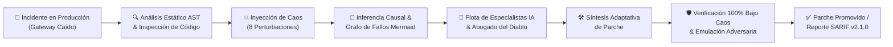

# FaultGraph-BX ⚡
### Autonomous Self-Healing & AI Incident Response for BoxLang
> **Hackathon Ortus Solutions x ANIA** — **Reto 01: INCIDENT ZERO**

[](https://boxlang.io)
[](file:///audit.bxs)
[](file:///tests/runner.bxs)
[](file:///models/SarifExporter.bx)
[-darkgreen.svg)](file:///models/Healer.bx)
[](https://adoptium.net)
[](file:///box.json)

---

## 📋 Resumen del Proyecto

**FaultGraph-BX** es un sistema autónomo de respuesta ante incidentes, ingeniería de caos y auto-reparación (*self-healing*) desarrollado íntegramente en **BoxLang nativo**. 

Diseñado específicamente para resolver el desafío **01 INCIDENT ZERO**, el sistema investiga fallos desconocidos en aplicaciones de producción analizando trazas de ejecución en vivo, código fuente (AST), configuración y documentación técnica, identificando la causa raíz con evidencia formal y sintetizando un parche verificable bajo estrés en milisegundos.



---

## 🎯 Cumplimiento de los Requisitos del Reto

| Requisito del Hackathon | Cómo lo resuelve FaultGraph-BX | Archivo Clave |
| :--- | :--- | :--- |
| **01 CORE REQUIREMENT**<br>*Identificar la causa raíz probable y aportar evidencia concluyente.* | Deduce de forma determinista y asistida por IA las causas críticas (`NULL_CONFIG_DEREF`, `TYPE_MISMATCH_NUMERIC`), correlacionando excepciones de runtime (`BoxCastException`), números de línea exactos, niveles de confianza y grafos de propagación visuales. | [`models/diagnosis/CausalDiagnosisEngine.bx`](file:///models/diagnosis/CausalDiagnosisEngine.bx)<br>[`models/synergy/SharedEvidenceGraph.bx`](file:///models/synergy/SharedEvidenceGraph.bx) |
| **02 GO FURTHER**<br>*Crear agentes especializados para logs, infraestructura, código fuente o diagnóstico.* | Flota multi-agente con 5 perfiles especializados delimitados (`SecuritySpecialist`, `CodeAnalysisSpecialist`, `ResearchSpecialist`, `VerificationSpecialist`, `OrchestratorSpecialist`) coordinados con un **Centinela Reactivo en Tiempo Real** (`LiveSentinel`) y un motor de emulación de adversarios. | [`models/SpecializedAIEngine.bx`](file:///models/SpecializedAIEngine.bx)<br>[`models/LiveSentinel.bx`](file:///models/LiveSentinel.bx)<br>[`agents/IncidentDirector.bx`](file:///agents/IncidentDirector.bx) |
| **03 COMMUNITY GOAL**<br>*Producir herramientas reutilizables, agent skills o componentes de análisis para la comunidad BoxLang.* | Módulo nativo para ForgeBox (`ModuleConfig.bx`) con ciclo de vida e interceptores, CLI universal de diagnóstico de logs (`diagnose_log.bxs`), escáner AST (`scan.bxs`), generador automático de pruebas de regresión (`AutoTestGenerator.bx`) y exportador SARIF v2.1.0 para GitHub Actions. | [`ModuleConfig.bx`](file:///ModuleConfig.bx)<br>[`diagnose_log.bxs`](file:///diagnose_log.bxs)<br>[`ci.bxs`](file:///ci.bxs)<br>[`models/SarifExporter.bx`](file:///models/SarifExporter.bx) |
| **04 BOXLANG AI**<br>*Agentes, herramientas, subagentes, RAG, structured output, pipelines, HITL.* | **100% implementado**: RAG Híbrido vectorial con RRF (`VectorStore.bx`), Sandbox de privilegios mínimos (`SecuritySandbox.bx`), Pipelines formales de 7 y 9 pasos, esquemas SARIF/JSON tipados y protección Human-in-the-Loop (`FAULTGRAPH_PROMOTE=1`). | [`models/VectorStore.bx`](file:///models/VectorStore.bx)<br>[`models/DiagnosticVerificationEngine.bx`](file:///models/DiagnosticVerificationEngine.bx)<br>[`models/synergy/CommonContract.bx`](file:///models/synergy/CommonContract.bx) |

---

## 🚀 Guía de Evaluación Rápida (Para Jueces)

### Prerrequisitos
1. **Java JDK 21+** instalado.
2. **BoxLang CLI (1.18.0+)** disponible en el PATH del sistema:
   ```bash
   boxlang --version
   ```

---

### 1. Demostración Principal (Incidente, Caos y Auto-Reparación)
Ejecuta el ciclo de vida completo de un incidente de producción:
```bash
boxlang run.bxs
```
> **Qué observar en la consola:**
> - **Fase 1 (Inspección)**: Detección AST del servicio [`target_app/PaymentService.bx`](file:///target_app/PaymentService.bx).
> - **Fase 2 (Producción)**: El cobro sano funciona, pero al caer el gateway externo, la contingencia (`fallbackCharge`) revienta con error 500.
> - **Fase 3 (Caos)**: Se inyectan 8 escenarios de fallo y sobreviven 1/8.
> - **Fase 4 (Causa Raíz)**: Deducción de `NULL_CONFIG_DEREF` y `TYPE_MISMATCH_NUMERIC`, generación del grafo Mermaid y cuestionamiento del Abogado del Diablo.
> - **Fase 5 (Parche)**: Síntesis del parche endurecido con diff en tiempo real.
> - **Fase 6 (Verificación)**: Se repite el MISMO caos contra el código parcheado: **8/8 sobreviven**.
> - **Fase 7 (Reporte)**: Emisión de reportes formales en Markdown y JSON.

---

### 2. Diagnóstico de Logs Externos (Herramienta Comunitaria)
Analiza cualquier archivo de log externo para extraer en milisegundos las excepciones y el grafo causal:
```bash
boxlang diagnose_log.bxs target_app/sample_crash.log
```

---

### 3. Banco de Pruebas Automatizado (195 Tests)
Ejecuta las 33 suites de pruebas unitarias, de integración, de resiliencia, adversarias, despliegue canary y SRE:
```bash
boxlang tests/runner.bxs
```
> Resultado verificado: **195 de 195 pruebas pasando al 100%**.

---

### 4. Auditoría de Gobernanza (BoxLang-First)
Comprueba el cumplimiento de directivas de gobernanza y la pureza del código:
```bash
boxlang audit.bxs
```
> Resultado verificado: **20,101 líneas de código ejecutable 100% BoxLang nativo (0% dependencias externas)**.

---

### 5. Calidad CI/CD y Exportación SARIF v2.1.0
Ejecuta el escáner de integración continua compatible con GitHub Actions Code Scanning:
```bash
boxlang ci.bxs --target target_app/ --output reports/faultgraph.sarif --fail-on HIGH
```

---

### 6. Dashboard Web Interactivo
Inicia el servidor HTTP embebido para monitorear incidentes, telemetría y APIs REST:
```bash
boxlang dashboard.bxs
```
Accede desde el navegador a: `http://localhost:8095`

---

## 🤖 Arquitectura Multi-Agente

FaultGraph-BX desacopla la responsabilidad del diagnóstico en agentes y especialistas con tareas específicas:

```
agents/
  └── IncidentDirector.bx          <- Orquestador general del ciclo de vida

models/
  ├── SpecializedAIEngine.bx       <- Flota de Especialistas de IA Bajo Demanda:
  │     ├── SecuritySpecialist     <- Detección de vulnerabilidades CWE y OWASP
  │     ├── CodeAnalysisSpecialist <- Comprensión de trazas JVM y relaciones AST
  │     ├── ResearchSpecialist     <- Correlación técnica con documentación y KB
  │     ├── VerificationSpecialist <- Abogado del Diablo (cuestionamiento crítico)
  │     └── OrchestratorSpecialist <- Enrutamiento de herramientas deterministas vs LLM
  ├── LiveSentinel.bx              <- Centinela reactivo de streams de logs en vivo (<2ms)
  ├── adversary/
  │     ├── AttackSurfaceReconstructor.bx <- Mapeo de superficie y límites de confianza
  │     └── AdversaryEmulationEngine.bx   <- Emulación defensiva de hipótesis de ataque
  └── synergy/
        ├── IntelligentOrchestrator.bx    <- Coordinación adaptativa y arbitraje
        ├── SharedEvidenceGraph.bx        <- Grafo compartido de evidencias cruzadas
        └── CommonContract.bx             <- Normalización canónica de diagnósticos
```

---

---

## 🦙 Soporte de Modelos IA Local con Ollama

FaultGraph-BX integra una **estratificación de modelos locales** que se ejecutan 100% en tu máquina a través de Ollama, garantizando privacidad total, soberanía de datos y **cero consumo de tokens en la nube**:

| Modelo Local | Perfil en FaultGraph-BX | Misión y Responsabilidad | Variable de Entorno |
| :--- | :--- | :--- | :--- |
| **`qwen2.5-coder:3b`** | `lightweight` / `edge` | Triaje ultra-rápido, verificación sintáctica de AST, análisis en microsegundos y orquestación de herramientas. | `FAULTGRAPH_LIGHTWEIGHT_MODEL` |
| **`qwen2.5-coder:7b`** | `standard` *(default)* | Auditoría profunda de código, identificación de patrones de seguridad OWASP/CWE y síntesis de parches endurecidos. | `FAULTGRAPH_OLLAMA_MODEL` |
| **`deepseek-r1:7b`** *(DCB Utility)* | `deep_investigation` / `deepseek` | Razonamiento causal profundo (*Chain-of-Thought / CoT*), deducción de fallos multidimensionales complejos y cuestionamiento como Abogado del Diablo. | `FAULTGRAPH_DEEP_REASONING_MODEL` |

### Cómo seleccionar el perfil de IA:
```bash
# Perfil Estándar (Qwen 2.5 Coder 7B)
set FAULTGRAPH_AI_PROFILE=standard

# Perfil de Razonamiento Profundo (DeepSeek R1 / DCB Utility para análisis complejo CoT)
set FAULTGRAPH_AI_PROFILE=deep_investigation

# Perfil Ligero (Qwen 2.5 Coder 3B para máquinas con recursos reducidos)
set FAULTGRAPH_AI_PROFILE=lightweight

# Modo Offline Absoluto (0 llamadas a Ollama, 100% determinista)
set FAULTGRAPH_OFFLINE=1
```

### Descarga rápida de modelos en Ollama:
```bash
ollama pull qwen2.5-coder:3b
ollama pull qwen2.5-coder:7b
ollama pull deepseek-r1:7b
```

---

## 🔄 Aplicación en Repositorios Externos y Auto-Edición (Self-Healing)

FaultGraph-BX no está atado a un único servicio de prueba; fue diseñado como una **suite universal de diagnóstico y auto-reparación** aplicable a cualquier proyecto o repositorio:

### 1. Escaneo y Diagnóstico de Cualquier Repositorio
Puedes apuntar el escáner a cualquier proyecto local o clonado:
```bash
# Escaneo directo indicando la ruta del proyecto
boxlang scan.bxs c:/ruta/a/tu/proyecto

# Escaneo avanzado multilingüe con correlación de superficie de ataque
boxlang scan.bxs c:/ruta/a/tu/proyecto --polyglot --synergy
```

### 2. Ingesta y Censo Arquitectónico de Cualquier Repositorio
Mapea puntos de entrada, dependencias, manifiestos y SPOFs (*Single Points of Failure*):
```bash
boxlang intake.bxs c:/ruta/a/tu/proyecto
```

### 3. Pipeline CI/CD y Exportación SARIF para Cualquier Proyecto
Ejecuta la auditoría en tus pipelines de GitHub Actions o GitLab CI generando reportes estándar OASIS SARIF v2.1.0:
```bash
boxlang ci.bxs --target c:/ruta/a/tu/proyecto --output reports/auditoria.sarif --fail-on HIGH
```

### 4. Centinela en Tiempo Real para Cualquier Aplicación en Producción
Vigila cualquier archivo de log en vivo y sintetiza automáticamente pruebas de regresión ante cualquier excepción:
```bash
set FAULTGRAPH_WATCH_LOG=c:/ruta/a/mi_aplicacion/logs/error.log
boxlang watch.bxs
```

### 5. Auto-Edición y Promoción Autónoma de Parches (`FAULTGRAPH_PROMOTE=1`)
El software cuenta con la facultad de **editar y reparar directamente el código fuente en disco**:
- **Modo Sandbox por defecto**: El sistema genera el código corregido en un archivo paralelo ([`PaymentServicePatched.bx`](file:///target_app/PaymentServicePatched.bx)), ejecuta la batería de caos contra él y presenta el diff visual sin alterar producción.
- **Modo Auto-Edición / Promoción Activa**: Si se activa la bandera `FAULTGRAPH_PROMOTE=1`:
  ```bash
  # En Windows (cmd/PowerShell)
  set FAULTGRAPH_PROMOTE=1 && boxlang run.bxs
  
  # En Linux / macOS
  FAULTGRAPH_PROMOTE=1 boxlang run.bxs
  ```
  Al comprobar que el parche supera el **100% del caos**:
  1. Crea automáticamente una copia de respaldo del archivo original (`.bx.bak`).
  2. **Edita y sobreescribe de forma autónoma el código fuente objetivo** con la versión endurecida.
  3. Registra el evento de auto-reparación en el historial auditable de la base de conocimiento.

---

## 💡 Innovaciones Arquitectónicas en BoxLang

1. **Eficiencia Extrema & 0 Tokens Cloud Obligatorios**:
   - Funciona al 100% en modo determinista offline sin depender de APIs de pago externas ni conectividad a internet.
   - Si Ollama está disponible localmente, activa modelos compactos (Qwen2.5-Coder / Llama 3) para enriquecer el análisis.
2. **Concurrencia con Hilos Virtuales de la JVM**:
   - Ejecución paralela de escenarios de caos mediante `runAsync()` y el executor virtual `chaos-pool` definido en `.boxlang.json`.
3. **Caché Semántica L1 de Alto Rendimiento**:
   - `SemanticCache.bx` implementa almacenamiento en memoria sobre `ConcurrentHashMap` con consultas $O(1)$ sin I/O en disco.
4. **Búsqueda Vectorial Híbrida (RRF)**:
   - `VectorStore.bx` combina similitud léxica (BM25/palabras clave) y vectorial mediante *Reciprocal Rank Fusion*.
5. **Human-in-the-Loop (HITL) Protegido**:
   - El sistema jamás sobreescribe código de producción sin confirmación explícita del operador humano (`FAULTGRAPH_PROMOTE=1`).
6. **Aislamiento Seguro (`SecuritySandbox.bx`)**:
   - Prevención de *Path Traversal*, mitigación de SSRF en peticiones HTTP y validación determinista independiente para neutralizar alucinaciones de modelos de IA.

---

## 📁 Estructura del Repositorio

```text
├── agents/                       <- Orquestadores principales de incidentes
│   └── IncidentDirector.bx
├── models/                       <- Motores del dominio, agentes y especialistas
│   ├── adversary/                <- Reconstrucción de superficie y emulación de ataques
│   ├── alerting/                 <- Notificaciones multicanal ChatOps (Slack/Discord/Teams)
│   ├── diagnosis/                <- Inferencia causal y Generador SRE Post-Mortem
│   │     ├── CausalDiagnosisEngine.bx
│   │     └── SrePostMortemGenerator.bx   <- Google SRE / Blameless Post-Mortem & GitOps PR
│   ├── graph/                    <- Modelado de grafos estructurales y navegación topológica
│   ├── intake/                   <- Ingesta y censo de repositorios
│   ├── language/                 <- Inteligencia políglota y ecosistemas
│   ├── learning/                 <- Memoria de auto-aprendizaje continuo y Vaccine Packs
│   ├── orchestration/            <- Coordinación multi-motor y registro de herramientas
│   ├── reasoning/                <- Motor de razonamiento asistido por subgrafos
│   ├── resilience/               <- Patrones de resiliencia y alta disponibilidad
│   │     ├── CircuitBreaker.bx          <- Conmutación inmediata y fast-fail en fallback
│   │     └── CanaryRollbackManager.bx   <- Ventana canary y auto-reversión atómica
│   ├── synergy/                  <- Grafo de evidencias compartidas y contrato común
│   ├── verification/             <- Compuertas formales de verificación
│   ├── AstSecurityAnalyzer.bx    <- Analizador estático nativo BoxParser AST
│   ├── AutoTestGenerator.bx      <- Síntesis automática de tests de regresión
│   ├── ChaosEngine.bx            <- Inyector de perturbaciones y escenarios de caos
│   ├── DiagnosticVerificationEngine.bx <- Pipeline formal en 9 pasos
│   ├── Healer.bx                 <- Generador de parches y diffs
│   ├── KnowledgeBase.bx          <- Base de conocimiento estructurada y verificada
│   ├── LiveSentinel.bx           <- Centinela reactivo de logs en tiempo real
│   ├── LogDiagnosticIngestor.bx  <- Ingesta universal de logs y trazas
│   ├── RepositoryScanner.bx      <- Escáner de seguridad y calidad en lote
│   ├── SarifExporter.bx          <- Exportador estándar OASIS SARIF v2.1.0
│   ├── SecuritySandbox.bx        <- Sandbox de contención de privilegios mínimos
│   ├── SemanticCache.bx          <- Memoria L1 de alta velocidad con desalojo acotado
│   ├── ShadowTester.bx           <- Ejecución sombra de candidatos a despliegue
│   ├── SpecializedAIEngine.bx    <- Flota de agentes especialistas de IA
│   ├── VectorStore.bx            <- Motor vectorial híbrido (RRF)
│   ├── WebDashboard.bx           <- Servidor HTTP embebido para dashboard web
│   ├── interceptors/             <- Interceptores de ciclo de vida ColdBox
│   │   └── FaultGraphInterceptor.bx <- Captura de onException en vivo y sanitización
│   └── ast/                      <- Mutaciones y transformaciones de AST
│       └── AstTransformer.bx     <- Inyección de operadores Elvis y guardas defensivas
├── commands/                     <- Comandos CLI para CommandBox
│   └── faultgraph.bx             <- Comando unificado: box faultgraph doctor/scan/chaos
├── config/                       <- Gestión centralizada de configuración
│   └── Config.bx
├── target_app/                   <- Aplicación objetivo del reto
│   ├── PaymentService.bx         <- Servicio con defecto latente en fallback
│   └── sample_crash.log          <- Traza de error de ejemplo en producción
├── tests/                        <- Banco de pruebas automatizado (195 tests, 33 suites)
│   ├── harness/                  <- Aserciones y reporter
│   ├── suites/                   <- 33 suites exhaustivas de pruebas (100% éxito)
│   └── runner.bxs                <- Runner principal de tests
├── .github/workflows/            <- Pipeline de CI/CD para GitHub Actions
│   └── faultgraph-ci.yml
├── .boxlang.json                 <- Mappings y configuración de Virtual Threads
├── box.json                      <- Manifiesto del módulo ForgeBox
├── ModuleConfig.bx               <- Configuración y ciclo de vida del módulo BoxLang
├── run.bxs                       <- Demostración principal CLI
├── diagnose_log.bxs              <- CLI de diagnóstico de logs externos
├── audit.bxs                     <- Auditoría automática de gobernanza de código (19,297 LOC)
├── ci.bxs                        <- Runner de CI/CD (SARIF v2.1.0)
├── dashboard.bxs                 <- Lanzador del Dashboard Web
├── scan.bxs                      <- CLI de escaneo estático
├── watch.bxs                     <- CLI del centinela reactivo en tiempo real
└── README.md                     <- Documentación principal
```

---

## 👥 Autores y Créditos

Desarrollado para el **Hackathon Ortus Solutions x ANIA BoxLang + AI**  
**Reto:** `01 INCIDENT ZERO`  
**Licencia:** [MIT](LICENSE)
