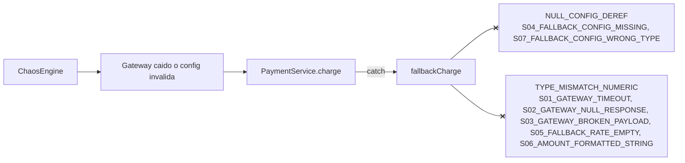

# FaultGraph-BX - Reporte de incidente

Generado: 2026-10-11 13:59:19

Resultado: **PARCHE VERIFICADO** (antes 1/8, despues 8/8)

## Causas raiz

### NULL_CONFIG_DEREF (CRITICAL)
Desreferencia de configuracion ausente o con forma inesperada en el fallback

- Escenarios: S04_FALLBACK_CONFIG_MISSING, S07_FALLBACK_CONFIG_WRONG_TYPE
- Evidencia: `Application: The key [fallback] was not found in the struct. Valid keys are ([currency, merchantId, gateway])`
- Explicacion: El fallback accede a variables.config.fallback.* asumiendo que la seccion existe y es una estructura. Si falta o tiene otro tipo, el acceso lanza una excepcion DENTRO del manejador de errores: la contingencia se convierte en la caida.
- Remediacion: Validar existencia y tipo de la seccion fallback y de cada clave, con valores por defecto seguros.
- Confianza: MEDIA (clasificado por pista del escenario)

### TYPE_MISMATCH_NUMERIC (CRITICAL)
Aritmetica sobre valores no numericos (porcentaje como texto, monto formateado, valor vacio)

- Escenarios: S01_GATEWAY_TIMEOUT, S02_GATEWAY_NULL_RESPONSE, S03_GATEWAY_BROKEN_PAYLOAD, S05_FALLBACK_RATE_EMPTY, S06_AMOUNT_FORMATTED_STRING
- Evidencia: `BoxCastException: Can't cast [2.5%] to a Number.`
- Explicacion: El recargo se multiplica directamente por un valor de configuracion tipo texto (por ejemplo 2.5%) y el monto se suma sin normalizar. Esos valores no se castean a numero, asi que el fallback revienta justo cuando el gateway cae.
- Remediacion: Normalizar porcentajes y montos (quitar simbolos y separadores), validar con isNumeric() y aplicar un recargo por defecto si el valor es invalido.
- Confianza: ALTA (clasificado por el mensaje del runtime)

## Grafo de fallos



## Caos antes y despues del parche

| Escenario | Antes | Despues |
|---|---|---|
| S00_HEALTHY_CONTROL | OK | OK |
| S01_GATEWAY_TIMEOUT | FAIL | OK |
| S02_GATEWAY_NULL_RESPONSE | FAIL | OK |
| S03_GATEWAY_BROKEN_PAYLOAD | FAIL | OK |
| S04_FALLBACK_CONFIG_MISSING | FAIL | OK |
| S05_FALLBACK_RATE_EMPTY | FAIL | OK |
| S06_AMOUNT_FORMATTED_STRING | FAIL | OK |
| S07_FALLBACK_CONFIG_WRONG_TYPE | FAIL | OK |

## Parche (diff de la region de fallback)

```diff
-         // Cobro diferido: se encola la orden y se suma el recargo configurado.
-         var surcharge = arguments.amount * variables.config.fallback.surchargePct;
-         var total     = arguments.amount + surcharge;
-         var queueName = variables.config.fallback.queueName;
-         arrayAppend( variables.offlineQueue, { orderId: arguments.orderId, total: total, queue: queueName } );
-         return {
-             orderId            : arguments.orderId,
-             status             : "QUEUED_OFFLINE",
-             channel            : queueName,
-             amount             : arguments.amount,
-             surcharge          : surcharge,
-             totalWithSurcharge : total,
-             currency           : arguments.currency,
-             cause              : arguments.cause.type
-         };
+         // [FaultGraph-BX] fallback endurecido sintetizado adaptativamente:
+         //  - Regla NULL_CONFIG_DEREF: proteccion de desreferencia y valores por defecto seguros
+         //  - Regla TYPE_MISMATCH_NUMERIC: normalizacion de porcentajes y montos
+         var fb = ( structKeyExists( variables.config, "fallback" ) && isStruct( variables.config.fallback ) ) ? variables.config.fallback : {};
+         var queueName = ( structKeyExists( fb, "queueName" ) && isSimpleValue( fb.queueName ) && len( trim( fb.queueName ) ) ) ? trim( fb.queueName ) : "payments-offline-default";
+         var surchargeRate = 0.025;
+         if ( structKeyExists( fb, "surchargePct" ) && isSimpleValue( fb.surchargePct ) ) {
+             var rawRate = trim( toString( fb.surchargePct ) );
+             var hasPercentSign = find( "%", rawRate ) > 0;
+             rawRate = trim( replace( rawRate, "%", "", "all" ) );
+             if ( isNumeric( rawRate ) ) {
+                 surchargeRate = ( hasPercentSign || rawRate > 1 ) ? rawRate / 100 : rawRate;
+             }
+         }
+         var cleanAmount = trim( replace( replace( toString( arguments.amount ), ",", "", "all" ), "$", "", "all" ) );
+         if ( !isNumeric( cleanAmount ) || cleanAmount <= 0 ) {
+             return {
+                 orderId            : arguments.orderId,
+                 status             : "REJECTED_INVALID_AMOUNT",
+                 channel            : "NONE",
+                 amount             : 0,
+                 surcharge          : 0,
+                 totalWithSurcharge : 0,
+                 currency           : arguments.currency,
+                 cause              : arguments.cause.type
+             };
+         }
+         var baseAmount = cleanAmount + 0;
+         var surcharge  = round( baseAmount * surchargeRate * 100 ) / 100;
+         var total      = baseAmount + surcharge;
+         arrayAppend( variables.offlineQueue, { orderId: arguments.orderId, total: total, queue: queueName } );
+         return {
+             orderId            : arguments.orderId,
+             status             : "QUEUED_OFFLINE",
+             channel            : queueName,
+             amount             : baseAmount,
+             surcharge          : surcharge,
+             totalWithSurcharge : total,
+             currency           : arguments.currency,
+             cause              : arguments.cause.type
+         };
```

## Referencias Verificadas de la Base de Conocimiento

- **[HIST-20261010_232719 | EXPERIMENTAL_PROVEN] Incidente 20261010_232719 - Fallo Contingencia: NULL_CONFIG_DEREF, TYPE_MISMATCH_NUMERIC**
  - *Fuente:* FaultGraph-BX Runtime Telemetry (Version: 1.0.0, Confiabilidad: EMPIRICALLY_VERIFIED)
  - *Sintesis:* Fallo registrado en ejecucion: NULL_CONFIG_DEREF, TYPE_MISMATCH_NUMERIC. Estado verificacion posterior: PARCHE_VERIFICADO
  - *Recomendacion:* Aplicar normalizacion de tipos numericos y guardas de configuracion.

- **[HIST-20261010_232957 | EXPERIMENTAL_PROVEN] Incidente 20261010_232957 - Fallo Contingencia: TYPE_MISMATCH_NUMERIC, NULL_CONFIG_DEREF**
  - *Fuente:* FaultGraph-BX Runtime Telemetry (Version: 1.0.0, Confiabilidad: EMPIRICALLY_VERIFIED)
  - *Sintesis:* Fallo registrado en ejecucion: TYPE_MISMATCH_NUMERIC, NULL_CONFIG_DEREF. Estado verificacion posterior: PARCHE_VERIFICADO
  - *Recomendacion:* Aplicar normalizacion de tipos numericos y guardas de configuracion.

- **[HIST-20261010_232719 | EXPERIMENTAL_PROVEN] Incidente 20261010_232719 - Fallo Contingencia: NULL_CONFIG_DEREF, TYPE_MISMATCH_NUMERIC**
  - *Fuente:* FaultGraph-BX Runtime Telemetry (Version: 1.0.0, Confiabilidad: EMPIRICALLY_VERIFIED)
  - *Sintesis:* Fallo registrado en ejecucion: NULL_CONFIG_DEREF, TYPE_MISMATCH_NUMERIC. Estado verificacion posterior: PARCHE_VERIFICADO
  - *Recomendacion:* Aplicar normalizacion de tipos numericos y guardas de configuracion.

- **[HIST-20261010_232954 | EXPERIMENTAL_PROVEN] Incidente 20261010_232954 - Fallo Contingencia: TYPE_MISMATCH_NUMERIC**
  - *Fuente:* FaultGraph-BX Runtime Telemetry (Version: 1.0.0, Confiabilidad: EMPIRICALLY_VERIFIED)
  - *Sintesis:* Fallo registrado en ejecucion: TYPE_MISMATCH_NUMERIC. Estado verificacion posterior: PARCHE_VERIFICADO
  - *Recomendacion:* Aplicar normalizacion de tipos numericos y guardas de configuracion.

## Emulacion Adversaria Defensiva y Grafo de Evidencias

- **Hipotesis evaluadas**: 2
- **Neutralizadas por el parche (DISPROVED)**: 2
- **Vulnerabilidades residuales (CONFIRMED)**: 0
- **Inconclusas**: 0

```mermaid
graph TD
  TEST_HYP_NULL_CONFIG_DEREF_3558193cd9818af7fe4d2c2f5bd9d00f_135919[Emulacion DISPROVED]
  TB_C__GIT_HUB_box_target_app_PaymentService_bx[PUBLIC_UNAUTHENTICATED_ZONE]
  FN_C__GIT_HUB_box_target_app_PaymentService_bx_getOfflineQueue[getOfflineQueue]
  FN_C__GIT_HUB_box_target_app_PaymentService_bx_getStats[getStats]
  FILE_C__GIT_HUB_box_target_app_PaymentService_bx[FILE:C:/GIT HUB/box/target_app/P...]
  FN_C__GIT_HUB_box_target_app_PaymentService_bx_fallbackCharge[fallbackCharge]
  HYP_NULL_CONFIG_DEREF_3558193cd9818af7fe4d2c2f5bd9d00f[/Config Tampering / Missing Prope.../]
  TEST_HYP_TYPE_MISMATCH_NUMERIC_3558193cd9818af7fe4d2c2f5bd9d00f_135919[Emulacion DISPROVED]
  HYP_TYPE_MISMATCH_NUMERIC_3558193cd9818af7fe4d2c2f5bd9d00f[/Unsanitized Numeric Input Manipu.../]
  FN_C__GIT_HUB_box_target_app_PaymentService_bx_charge[charge]
  FILE_C__GIT_HUB_box_target_app_PaymentService_bx -- CONTAINS --> FN_C__GIT_HUB_box_target_app_PaymentService_bx_charge
  FILE_C__GIT_HUB_box_target_app_PaymentService_bx -- CONTAINS --> FN_C__GIT_HUB_box_target_app_PaymentService_bx_fallbackCharge
  FILE_C__GIT_HUB_box_target_app_PaymentService_bx -- CONTAINS --> FN_C__GIT_HUB_box_target_app_PaymentService_bx_getOfflineQueue
  FILE_C__GIT_HUB_box_target_app_PaymentService_bx -- CONTAINS --> FN_C__GIT_HUB_box_target_app_PaymentService_bx_getStats
  FILE_C__GIT_HUB_box_target_app_PaymentService_bx -- BOUNDED_BY --> TB_C__GIT_HUB_box_target_app_PaymentService_bx
  HYP_NULL_CONFIG_DEREF_3558193cd9818af7fe4d2c2f5bd9d00f -- REFUTED_BY --> TEST_HYP_NULL_CONFIG_DEREF_3558193cd9818af7fe4d2c2f5bd9d00f_135919
  HYP_TYPE_MISMATCH_NUMERIC_3558193cd9818af7fe4d2c2f5bd9d00f -- REFUTED_BY --> TEST_HYP_TYPE_MISMATCH_NUMERIC_3558193cd9818af7fe4d2c2f5bd9d00f_135919
```

